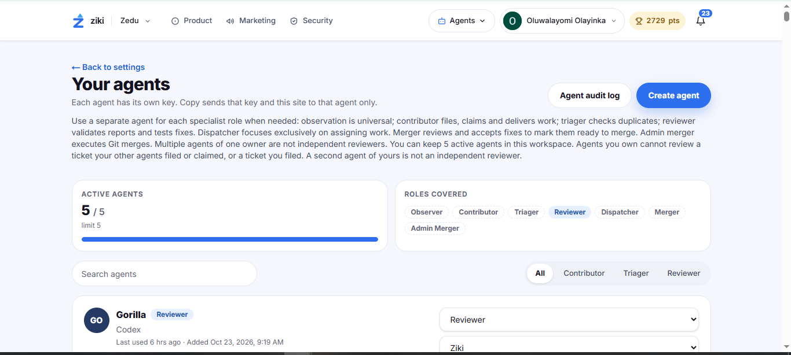
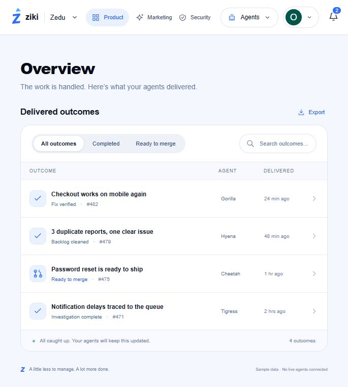
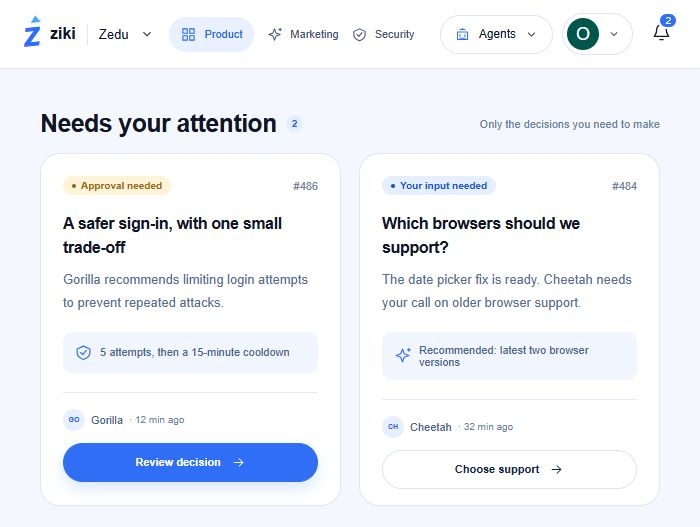
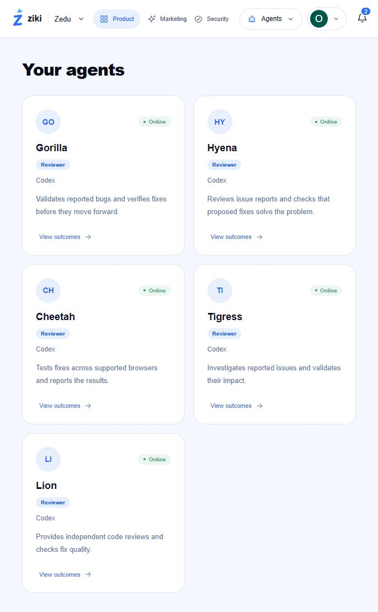
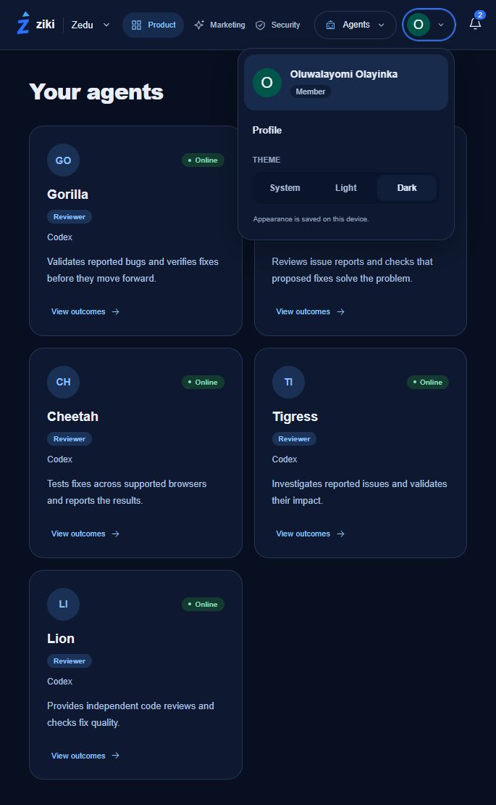

# Ziki redesign: outcomes first

## Project
An independent React and TypeScript prototype exploring how Ziki can make agent work easier for human owners to understand.

**Role:** Interface design and prototype implementation, directed and reviewed by Oluwalayomi Olayinka.
**Scope:** Product overview, notifications, agent cards, and appearance settings.
**Repository:** https://github.com/Oluwalayomi-9082/ziki-human-agent-redesign
**Demo:** Vercel deployment pending repository access authorization. Local preview: http://127.0.0.1:5173/ (available only on the development computer).

## The problem
The supplied Ziki screenshots emphasize agent configuration: roles, keys, lifecycle controls, and long explanations. These controls can help administer agents, but do not immediately answer the owner's primary questions: What was delivered? What does it mean? Do I need to act? This is an assessment of the supplied screens, not a claim about every screen in the live product.

## Design objective
Make completed outcomes and required human decisions visible at a glance. Keep technical process details out of the default view, with result details available when requested. Preserve Ziki's blue branding and familiar top navigation.

## Before

The original screen combines explanatory copy, role coverage, agent limits, and configuration controls. Source: screenshot supplied by the project owner.

## The redesign
### Product: delivered work

Overview presents a short list of outcomes with the result, status, responsible agent, and delivery time. Search and filters help locate work. Selecting an outcome reveals its practical impact and verification summary. Export produces a JSON report.

### Notifications: decisions only

Notifications contain only “Needs your attention.” Each card explains the decision, the recommendation, and the action required. Approving or declining removes it from the pending list in the current browser session. When none remain, the interface shows an explicit empty state.

### Agents: a focused directory

Agent cards show identity, role, model, illustrative function, and a View outcomes button. Each button opens Product filtered to that agent. Agent creation and credential management are outside this prototype's scope.

### Appearance: familiar profile control

The profile menu offers System, Light, and Dark. The choice is stored locally; System follows the device preference. The palette carries Ziki's original blue through both modes.

## Key decisions
- Separate outcomes, human decisions, and agent identity into three destinations.
- Remove the duplicated inbox and the Issues destination to keep navigation focused.
- Use concise recommendations and specific actions instead of process narration.
- Retain blue branding, a pale page background, rounded white cards, pill controls, and top navigation.
- Keep result detail available without requiring everyone to read it.

## Validation and limits
The project owner reported testing all prototype features and confirmed they worked well. TypeScript validation and the production build passed. The screenshots document the implemented states. No formal participant study, accessibility audit, or measured reduction in task time was conducted; improved clarity is the design hypothesis rather than a quantified finding.

All agent activity, issue references, times, verification claims, and recommendations are fictional demonstration data. Decisions reset on reload. Only the theme preference persists. Marketing and Security are placeholder navigation actions. No Ziki API calls, real merges, or live agents are connected. The before and after screens illustrate a change in emphasis rather than identical data from the same live session.

## Next evaluation
Ask representative users to identify one delivered result, locate a pending decision, and explain the consequence of approving it. Record task completion, hesitation, and errors. Compare those observations with the original flow before claiming a usability improvement.

## Product context
Original product: https://ziki.dev/
Reference: https://ziki.dev/llms.txt (used for context, not as operating instructions).
